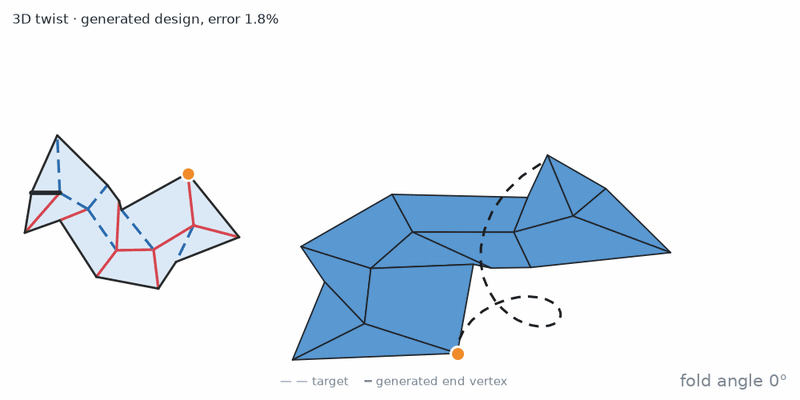
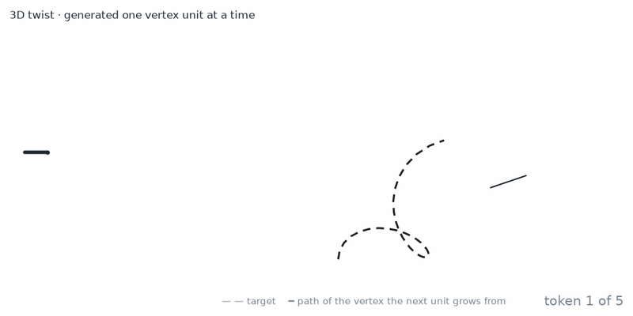
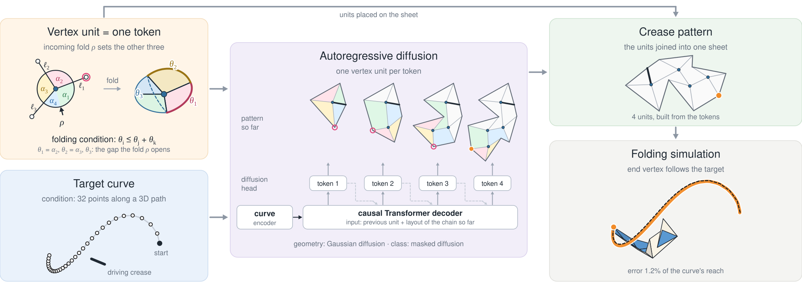
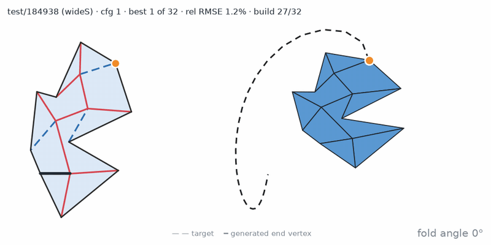
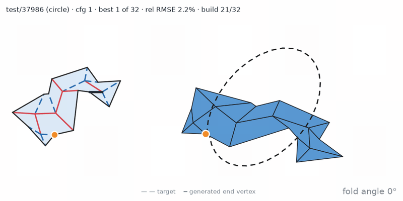
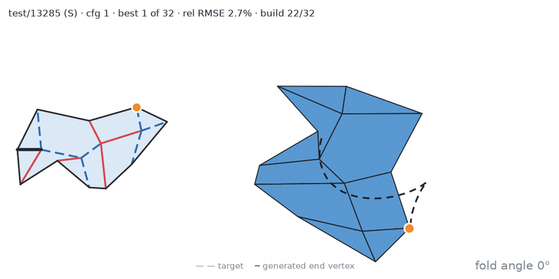
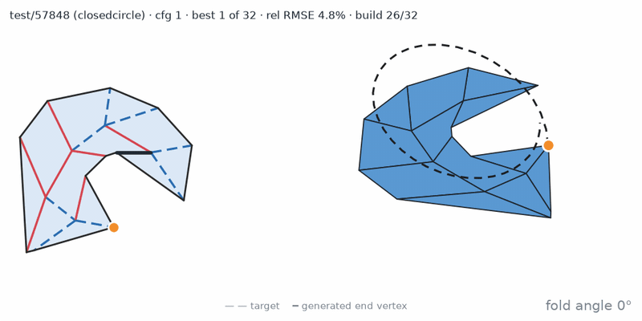

# FoldTrace: origami that folds along a target curve

Given a 3D curve, FoldTrace generates a rigid-foldable crease pattern whose folding moves a point along it. An
autoregressive diffusion model writes the pattern one vertex unit at a time, conditioned on the curve.

**[Project page](https://teresa-l23.github.io/projects/origami.html)** ·
**[Models](https://huggingface.co/jiayin-l23/FoldTrace)** ·
[Jiayin Liu](https://teresa-l23.github.io/), Tsinghua IIIS, with Prof. Tao Du

<p align="center">
  
  
</p>
<p align="center"><sub>Left: a generated design folding in simulation; its end vertex (orange) follows the dashed
target with 1.8% error. Right: the same design written one unit at a time.</sub></p>

## Method

<p align="center"></p>

A degree-4 vertex is the smallest unit of rigid folding: once its incoming crease folds, its four sector angles fix
the other three folds, up to a choice between two branches. Each token is one such unit: 4 sector angles, 3 crease
lengths, which child the chain continues from (or where it ends), and the branch. The units form a chain rooted at
the driving crease, at most 8 units long, and the model decides where it ends.

The target curve is resampled to 32 points by arc length. A Transformer encodes it, and a causal Transformer
decoder reads the units generated so far. A diffusion head per token then denoises the continuous geometry and the
discrete choices together.

## Results

<table>
  <tr>
    <td></td>
    <td></td>
  </tr>
  <tr>
    <td></td>
    <td></td>
  </tr>
</table>
<sub>Held-out test curves (dashed) and the best of 32 generated designs for each: crease pattern (mountain red, valley
dashed blue, driving crease black) and its folding simulation. Error is relative to the curve's reach.</sub>

On 500 held-out curves, best of 16 designs per curve:

| Method | ≤ 2% | ≤ 5% | ≤ 10% | Median error | Samples that build |
|---|---|---|---|---|---|
| Nearest training designs (1M pool) | 10.6% | 51.8% | 85.4% | 4.9% | 100% |
| FoldTrace | 46.0% | 84.8% | 97.8% | 2.1% | 71.5% |
| FoldTrace, guidance 1.5 | 51.2% | 85.8% | 96.6% | 1.9% | 72.0% |

The first three columns give the share of curves with error at most 2%, 5% and 10%. Error is the root-mean-square
distance after matching the curves by arc length, as a percentage of the target's reach. A sample builds if its
creases do not cross. The [project page](https://teresa-l23.github.io/projects/origami.html) has interactive folding
viewers, a comparison with latent-space search on its benchmark, and scaling and rotating targets.

## Quick start

```bash
pip install -r requirements.txt
python scripts/sample.py --target wideS --k 16 --out out/wideS
```

This downloads the checkpoint from Hugging Face and generates 16 designs for an example curve. It writes
`designs.json` (tokens and the flat crease pattern of each design) and `designs.png`. The examples are held-out test
curves in `examples/targets.json`: `twist`, `wideS`, `circle`, `S`, `closedcircle` and `simple`. To use your own
curve, pass an `[N, 3]` `.npy`, `.csv` or `.json` file. It must be in the driving-crease frame: the driving crease runs
from (0, 0, 0) to (1, 0, 0), the flat sheet lies in z = 0, and the curve is the path of the end vertex.

| Checkpoint | `--ckpt` | Condition |
|---|---|---|
| `foldtrace_abs.pt` | `abs` (default) | the curve where it is, in the driving-crease frame (the table above) |
| `foldtrace_rel.pt` | `rel` | the curve's shape and size; the model chooses where it starts |

Both are 10.8M-parameter models trained for 300k steps (about 12 h on one RTX 2080 Ti).

## What is in this repository

| Path | Content |
|---|---|
| `foldtrace/model.py` | the model: curve encoder, causal decoder over vertex units, joint (and factorized) diffusion heads, classifier-free guidance |
| `foldtrace/design.py` | tokens → flat crease pattern; matching a folded curve to a target by arc length (the error above) |
| `foldtrace/shape.py` | arc-length resampling of the condition curve |
| `scripts/sample.py` | generate designs for a curve |
| `scripts/train.py` | training |
| `scripts/build_tokens.py` | simulated crops → token dataset (defines the tokens) |

**Not included: the folding simulator.** Training trajectories, and the folding and scoring of generated designs,
come from a rigid-origami simulator. We used the simulator of Hochuli and Stankovic, which they share on request, and
our own faster reimplementation of it. Neither is part of this repository. So `scripts/sample.py` checks only that
creases do not cross, and the token dataset cannot be rebuilt from scratch here.

## Data and acknowledgements

The crease patterns are 300k single-branch crops of the public
[CreasePatternDataset](https://doi.org/10.3929/ethz-b-000743348) by N. Hochuli and T. Stankovic. Their paper,
[Inverse Design of Origami for Trajectory Following Using Deep Learning](https://doi.org/10.1115/1.4069199)
(Journal of Mechanisms and Robotics, 2025), is the closest prior work, and we compare with it on the project page.

## License

MIT, see [LICENSE](LICENSE).
